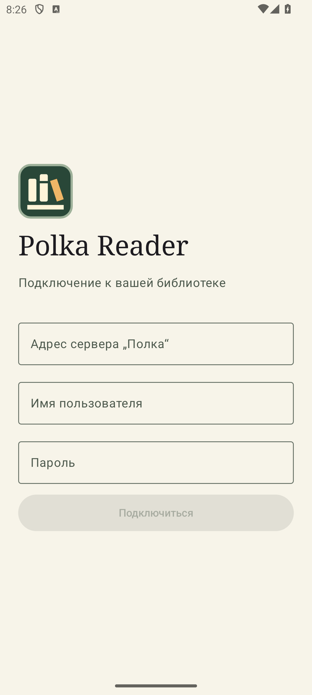
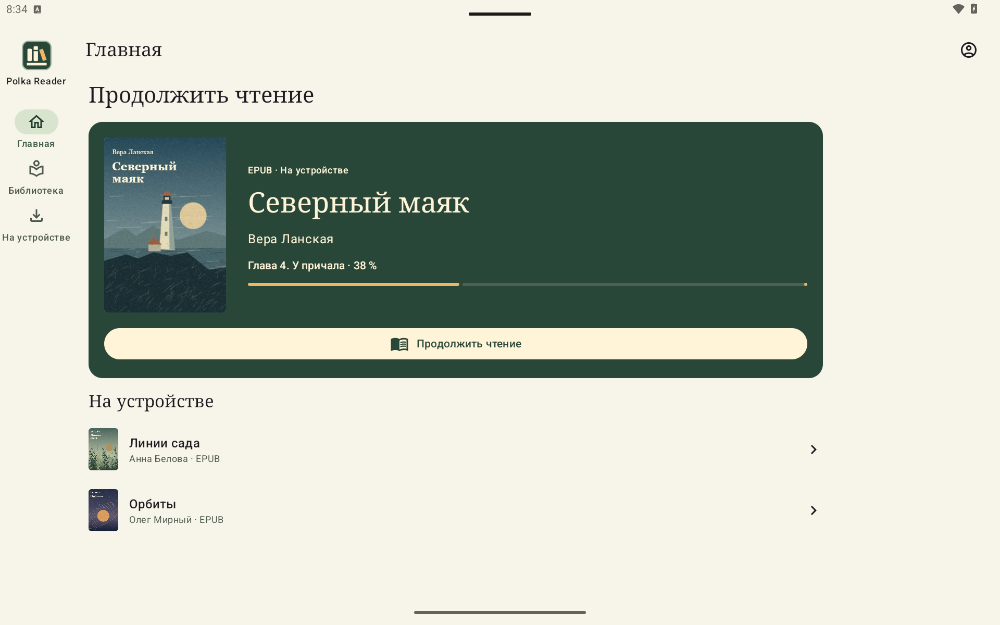
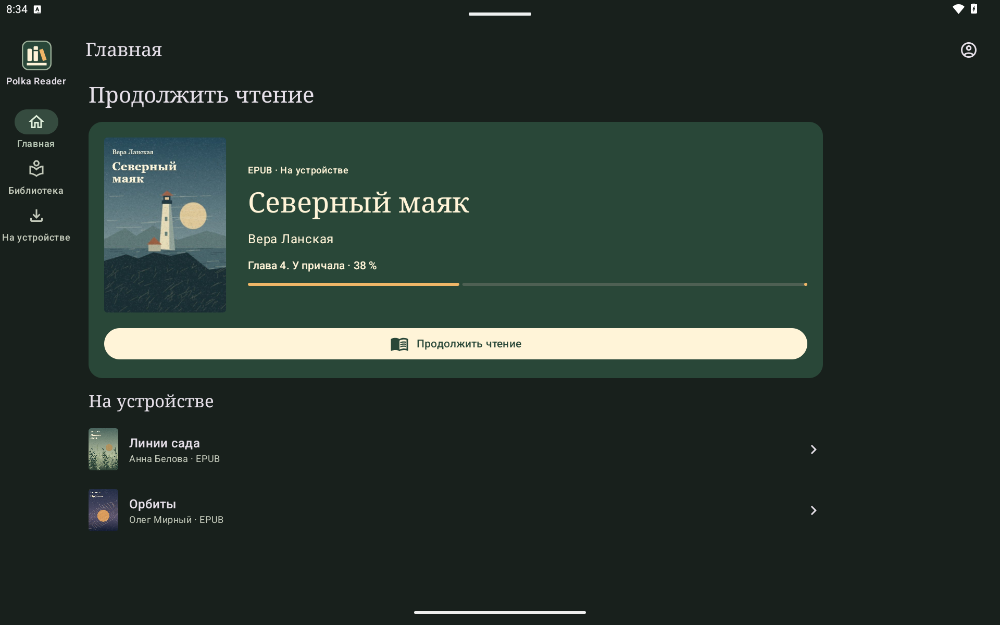

# Polka Reader

Android-приложение для домашнего книжного сервера «Полка». Скачайте EPUB или PDF, читайте без сети и продолжайте с сохранённого места в браузере или на другом Android-устройстве. Первая версия клиента — **0.1.0**, минимальная версия Android — **8.0 (API 26)**. Проверка совместимости проводилась с [«Полкой» v0.3.0](https://github.com/Benya9669/Polka/tree/v0.3.0).

## Скачать и обновить

На телефоне или планшете скачайте универсальный `Polka-Reader-X.Y.Z.apk` из раздела **Assets** и откройте его. Для обновления установленной релизной версии выберите **Обновить**. При совпадающем ключе подписи Android сохраняет скачанные книги, сеанс и места чтения. [Скачать APK](https://github.com/Benya9669/PolkaReader/releases/latest).

Файл `.apk.sha256` рядом с APK позволяет проверить скачивание. Для владельца описаны формат `VERSION`, резервная копия ключа, четыре секрета GitHub Actions и повторная публикация. [Проверка подписи и выпуск новой версии](docs/releases.md).

## Сборка и установка через adb

Для сборки нужны JDK, Android SDK Platform 36 и Platform Tools с `adb`. На Windows сборка проверена с JBR 25 из Android Studio. Код компилируется для Java 17. В Android Studio можно открыть корневую папку проекта и установить предложенные SDK Build Tools через SDK Manager. Для командной строки задайте `ANDROID_HOME` или откройте проект в Android Studio, чтобы она создала локальный `local.properties`. Gradle 9.5.0 и версии зависимостей зафиксированы в проекте. При первой сборке Wrapper и библиотеки загружаются из сети.

В PowerShell из корня репозитория выполните:

```powershell
$env:JAVA_HOME = 'C:\Program Files\Android\Android Studio\jbr'
.\gradlew.bat :app:testDebugUnitTest :app:assembleDebug
```

В Linux и macOS используйте `./gradlew :app:testDebugUnitTest :app:assembleDebug`. Готовый APK находится в `app/build/outputs/apk/debug/app-debug.apk`. Он подписан локальным отладочным ключом. Для обновления с сохранением данных используйте сборку с тем же ключом.

Включите отладку по USB, подключите телефон или запустите эмулятор и подтвердите подключение на экране устройства.

```shell
adb devices
adb install -r app/build/outputs/apk/debug/app-debug.apk
adb shell am start -n ru.polka.reader/.MainActivity
```

Если подключено несколько устройств, добавьте `-s <серийный-номер>` сразу после `adb`.

## Подключение и первая книга

1. Проверьте с телефона в браузере, что открывается веб-интерфейс вашей «Полки». Для домашнего сервера подключитесь к домашней Wi-Fi-сети или к своему VPN. В приложении введите тот же адрес, например `https://polka.example.org` или `http://192.168.1.20:8080`. Сохраните префикс пути, если его использует ваш обратный прокси. Клиент добавляет `/api/v1` самостоятельно.
2. Если сервер запущен в Docker, укажите LAN-адрес хоста и уже опубликованный порт веб-интерфейса. Проверить сопоставление портов можно командой `docker compose ps` в каталоге сервера. На телефоне `localhost` указывает на сам телефон. В стандартном Android Emulator адрес `10.0.2.2` ведёт к компьютеру-хосту.
3. Войдите под обычной учётной записью «Полки». Клиент использует сессионную cookie `ebook_session`, а ключ её шифрования хранится в Android Keystore. Для HTTPS сертификат должен проходить системную проверку. HTTP разрешён для явно введённого локального адреса и передаёт учётные данные без шифрования.
4. В разделе **Библиотека** найдите произведение по названию или автору, выберите издание и нажмите **Скачать** у нужного файла. Дождитесь надписи **Доступна офлайн**. Приложение пишет загрузку во временный файл и сверяет размер и SHA-256 перед публикацией. У готовой книги нажмите **Читать**.
5. Откройте **Главная → Продолжить чтение** для возврата к книге. В разделе **На устройстве** можно удалить скачанную копию. Оригинал и место чтения на сервере сохраняются.

## Чтение и синхронизация

| Формат | На устройстве | Место чтения |
| --- | --- | --- |
| EPUB | Оглавление, шрифт, интервал, поля и тема страницы. Касание текста переключает панели. | Точный CFI `epubcfi(...)` для конкретного файла. |
| PDF | Постраничное чтение, масштабирование кнопками и жестом, переход по номеру. Страницы рисует Android PdfRenderer. | Номер страницы строкой, начиная с `"1"`. |
| FB2, LRF и другие исходники | Откройте готовую EPUB/PDF-копию из карточки. Для поддерживаемого формата владелец библиотеки или администратор с правом записи может запустить серверную конвертацию. | После конвертации используется ID полученного файла. |

Приложение и книги имеют отдельные настройки темы. На узком экране основные разделы доступны в нижней панели, на широком — сбоку. Для EPUB на широком экране можно оставить оглавление рядом с текстом. На Android 15 и новее в описание PDF-страницы для TalkBack входит доступный текстовый слой. Для сканов и на более ранних версиях Android доступен номер страницы. Распознавание текста сканов и выделения в PDF в эту версию не входят.

Читалка дожидается восстановления позиции при открытии. Затем каждое перемещение сохраняется в Room. После паузы в перелистывании, при выходе из читалки и после восстановления сети отправляется последнее изменение файла. Очередь переживает закрытие процесса, WorkManager повторяет отправку. Для синхронизации дома сервер должен снова стать доступен по сохранённому адресу. После истечения сессии повторно войдите под той же учётной записью. Локальная позиция и очередь сохранятся.

При конфликте показаны обе позиции, их устройства и время при наличии. Можно выбрать **Продолжить с этого устройства** или **Перейти к позиции сервера**, в том числе если вы вернулись к более ранней главе. Для другого файла того же произведения приложение предлагает приблизительный переход по проценту. После подтверждения оно сохраняет точный CFI или страницу открытого файла. Каталог, загрузки и очередь разделены по URL сервера и ID пользователя.

Для EPUB и PDF доступны серверные закладки. В EPUB выделите фрагмент долгим нажатием, чтобы сохранить цитату и добавить заметку. Закладки, выделения и заметки требуют соединения с сервером. Диалог показывает результат сохранения или ошибку. Статус **Синхронизировано** в панели чтения относится к позиции.

Нативные экраны написаны на Kotlin, Compose и Material 3. EPUB отображается в изолированном WebView, epub.js 0.3.93 и JSZip входят в APK. Серверную сессию обслуживает нативный клиент. Настройки оформления хранятся в DataStore. Контракты проверялись по `/openapi.json` работающего сервера и обработчикам релиза. [Описание API](https://github.com/Benya9669/Polka/blob/v0.3.0/docs/api.md) · [Прогресс и конфликты](https://github.com/Benya9669/Polka/blob/v0.3.0/backend/app/reading.py) · [Веб-читалка](https://github.com/Benya9669/Polka/blob/v0.3.0/frontend/src/reader.tsx).

## Проверка

Для сквозных проверок «Полка» v0.3.0 работала локально на компьютере разработчика с отдельной SQLite-базой и синтетическими книгами. Использовались эмуляторы телефона и планшета.

- **EPUB, веб → телефон → веб.** Веб-читалка сохранила первую главу «Северной полки». Телефон скачал EPUB, восстановил первую главу после смены шрифта и поворота, прочитал вторую главу в авиарежиме и открыл её после принудительной остановки процесса. После возвращения сети Android отправил CFI. Чистый сеанс браузера сразу показал абзац «Проверка восстановления позиции.» во второй главе. Версия позиции выросла с 2 до 3.
- **PDF, телефон → планшет.** На телефоне открыли страницу 17 из 24. Планшет под тем же аккаунтом восстановил страницу 17. Проверены обе ориентации планшета.
- **Конфликт двух устройств.** Телефон и планшет независимо вернулись с 17-й на 14-ю и 9-ю страницы в авиарежиме. После подключения планшет показал обе позиции. Выбранная читателем 9-я страница сохранилась на сервере и открылась на телефоне.
- **Переход между изданиями.** Для отдельного произведения сервер предложил 75 % из первого PDF (6-я страница из 8). До подтверждения планшет сохранил прежнюю серверную версию второго файла. После подтверждения на сервере появилась точная страница 15 из 20 второго PDF, в первом осталась страница 6.
- **Данные и доступ.** Инструментальный `LiveDataTest` прошёл с настоящим API, включая вход, поиск, проверку контрольной суммы файла, работу с личными записями, отзыв сессии и изоляцию двух пользователей.
- **Подписанное обновление 0.1.0 → 0.1.1.** На отдельном Pixel 9a установили через `adb install -r` две release-сборки с одним временным ключом. В авиарежиме сохранились сеанс, скачанный EPUB, вторая глава, тёмная тема приложения, сепия и шрифт 120 %. После подключения очередь отправила точный CFI на сервер без повторного входа.

На тестовых данных прошли восемь JVM-тестов и четыре инструментальных теста Room на планшете. Они проверяют контракты, устойчивость очереди при повторном открытии базы, изоляцию, обработку устаревших ответов, сортировку по времени чтения и оба выбора при конфликте. Отдельной ручной проверки с TalkBack на физическом устройстве пока не проводилось.

Запустите автоматические проверки на подключённом устройстве или эмуляторе:

```powershell
.\gradlew.bat :app:testDebugUnitTest :app:lintDebug
.\gradlew.bat :app:connectedDebugAndroidTest "-Pandroid.testInstrumentationRunnerArguments.class=ru.polka.reader.sync.ProgressStorageTest"
```

### Как повторить проверку EPUB

Для запуска тестовой «Полки» нужны Python 3.12, Node.js 22, Git и Chromium (Chrome или Edge). Команды ниже рассчитаны на PowerShell и новый изолированный стенд. Они создают каталог `.verification` с отдельной базой. Используйте отдельный Android Emulator с установленным debug APK.

```powershell
New-Item -ItemType Directory -Force .verification | Out-Null
git clone --depth 1 --branch v0.3.0 https://github.com/Benya9669/Polka.git .verification/Polka
npm --prefix .verification/Polka/frontend ci
npm --prefix .verification/Polka/frontend run build
py -3.12 -m venv .verification/venv
.\.verification\venv\Scripts\python.exe -m pip install -r .verification/Polka/backend/requirements.txt httpx==0.28.1
```

Сначала можно запустить маленький CFI-прототип. На тестовом EPUB из 90 абзацев он проверяет совпадение видимого абзаца при обмене CFI, смене шрифта и ширины, затем передаёт новый CFI обратно. Тест запускает в Chromium движок веб-читалки и HTML-ресурсы из Android-проекта.

```powershell
node tools/reader/cfi-probe.cjs .verification/Polka/frontend
```

Запустите локальный сервер в первом терминале. Задайте отдельный тестовый пароль из 10–64 латинских букв и цифр для автоматического ввода на эмуляторе. Команда запрашивает пароль без отображения на экране.

```powershell
$env:POLKA_QA_PASSWORD = [Net.NetworkCredential]::new('', (Read-Host 'Пароль тестового стенда' -AsSecureString)).Password
.\.verification\venv\Scripts\python.exe tools/qa/serve_fixture.py .verification/Polka .verification/fixture
```

Во втором терминале задайте ту же переменную через `Read-Host` и подставьте серийный номер отдельного эмулятора из `adb devices`. Этап `offline` переключает его авиарежим и перезапускает приложение. Для браузера вне стандартного пути Windows задайте `BROWSER_PATH` с полным путём к исполняемому файлу.

```powershell
$env:POLKA_QA_PASSWORD = [Net.NetworkCredential]::new('', (Read-Host 'Пароль тестового стенда' -AsSecureString)).Password
$serial = 'emulator-5554'
adb -s $serial reverse tcp:18763 tcp:18763
node tools/qa/web-check.cjs seed
.\.verification\venv\Scripts\python.exe tools/qa/phone_flow.py login --serial $serial
.\.verification\venv\Scripts\python.exe tools/qa/phone_flow.py epub --serial $serial
.\.verification\venv\Scripts\python.exe tools/qa/phone_flow.py offline --serial $serial
node tools/qa/web-check.cjs verify
adb -s $serial reverse --remove tcp:18763
```

В финале браузер должен открыть вторую главу сразу и вывести CFI, записанный Android. Для ручного повтора используйте EPUB в своей библиотеке, войдите в один аккаунт в обоих клиентах и откройте в браузере тот же `file_id`.

## Макеты

Откройте локальную галерею в браузере, чтобы переключаться между вариантами для телефона и планшета. [Интерактивная галерея](design/index.html) · [Переплёт](design/binding.png) · [Чернила](design/ink.png) · [Ночная полка](design/night.png).

## Как выглядит приложение

В приложение вошёл «Переплёт». Ниже показаны экраны работающего приложения на эмуляторах Medium Phone и Small Tablet. Обложки и книги на планшете взяты из демонстрационной библиотеки.

| Первое подключение | Главная на планшете | Тёмная тема |
| --- | --- | --- |
| [](design/brand/phone-connect.png) | [](design/brand/tablet-home.png) | [](design/brand/dark-home.png) |

У иконки две прямые книги и наклонённая янтарная книга над полкой. Для Android 13 и новее есть монохромный слой. Здесь показаны маски, отрисованные из векторных ресурсов приложения. [Круглая](design/brand/circle.png) · [Скруглённый квадрат](design/brand/rounded.png) · [Монохромная](design/brand/monochrome.png) · [Исходный знак «Полки»](https://github.com/Benya9669/Polka/blob/v0.3.1/frontend/public/assets/polka-mark.svg).

На планшете можно оставить тёмными панели приложения и выбрать светлую бумагу для EPUB. [Снимок открытой книги](design/brand/tablet-reading.png) · [Иконка установленного приложения в Pixel Launcher](design/brand/launcher-device.png).

В светлой и тёмной палитрах соответственно контраст основного текста с фоном составляет 13,12:1 и 13,47:1, надписи на основной кнопке — 9,35:1 и 7,90:1, выбранного пункта навигации — 9,24:1 и 7,87:1. Контраст заполненной части индикатора чтения с дорожкой составляет 3,70:1. Экран подключения проверен с системным масштабом шрифта 160 %.
